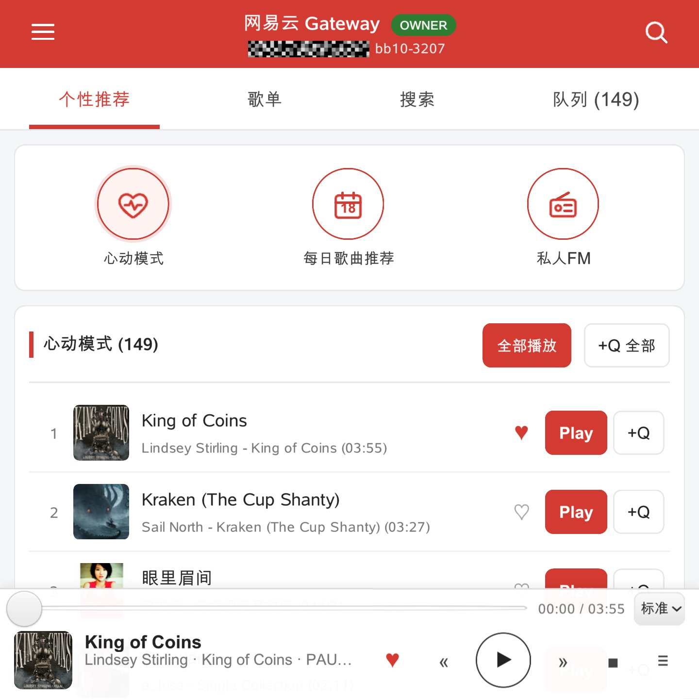
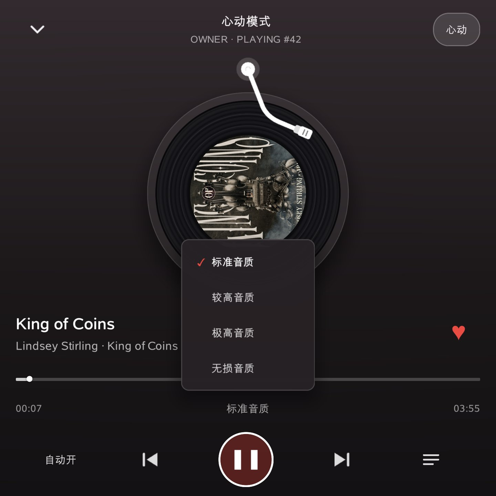

# bb10-music163

English | [简体中文](README_cn.md)

> Keep your BlackBerry Passport useful for music: run a Rust NetEase Cloud Music gateway on your NAS, stream real-time Range audio over a built-in OpenSSL TLS bridge, and play with a zero-build ES5 vinyl UI.

| Discover & Playlist Queue (BB10 1:1) | Full-Screen Vinyl Turntable & Quality Menu |
| --- | --- |
|  |  |

## Why

BlackBerry 10 (OS 10.3.3) has no working official music client, lacks modern TLS 1.2/1.3 cipher suites, and cannot decode hardware-DRM streams (FairPlay / Widevine). Instead of giving up on the Passport's hardware audio output and physical keyboard, `bb10-music163` moves upstream API signing, proxy routing, and short-lived CDN handling onto a self-hosted Rust gateway:

- **Native BB10 TLS bridge (`bb10-shell`)**: Bundles a local `127.0.0.1` OpenSSL HTTP-to-HTTPS bridge inside a lightweight Cascades/Qt4 `.bar` shell so the stock BB10 `WebView` talks to modern HTTPS servers without SSL handshake errors or certificate popups.
- **Stateless Range media relay**: Proxies signed CDN audio streams (`MP3` / `AAC` / `FLAC`) with HTTP `206` byte-range seeking and automatic upstream URL refresh on expiry—never writing copyrighted audio files to disk.
- **Upgrade on the NAS only**: The player UI (`web/player.html`, zero-build strict ES5) and API/catalog fixes (such as hydrating >1,000 liked tracks) live on the gateway server, so most updates require no `.bar` reinstall.
- **Scale-to-zero on NAS**: Optional `Traefik + Sablier` overlay stops the gateway container after idle timeout so NAS drives can sleep, then wakes it on demand in ~1 second.

## How it works

```text
 BlackBerry Passport (bb10-shell Cascades/Qt4 + WebView)
      │  ▲  Local HTTP (127.0.0.1)
      ▼  │  LocalTlsBridge (Qt4 + OpenSSL + Internal Root CA)
 [Optional] VPS L4 Relay (TLS_GUARD=1) ──Tailscale──┐
      │                                                 │
      ▼                                                 ▼
 Traefik (:16380 HTTPS / :16381 HTTP) + Sablier ──► NAS Docker
      │
      ▼
 bb10-music163-gateway (Rust / Axum)
   ├── netease-adapter ──► [Optional] socks5h:// Proxy ──► NetEase API (Auth / Catalog / URLs)
   ├── media-relay     ──► Direct CDN Fetch ──► Range / 206 Audio Stream
   └── playback-session ── Single-owner monotonic generation + STOP ACK
```

## Features

| Module | What you get |
|---|---|
| **Gateway & Auth** (`crates/gateway`) | Axum HTTP API + Bearer token auth, bounded QR login polling, atomic `0600` cookie persistence, >1,000-track Favorites overflow hydration |
| **Media Relay** (`crates/media-relay`) | Stateless HTTP `Range` / `206` streaming, automatic URL refresh on expired CDN tokens (`403`/`410`), SSRF/destination allowlist, bounded backpressure |
| **Playback Arbitration** (`crates/playback-session`) | Single-owner monotonic `generation` state machine across desktop Safari/Chrome and BB10, `STOP ACK` exclusivity confirmation, restart floor persistence |
| **ES5 Web Player** (`web/player.html`) | Zero-build vanilla ES5 UI compatible with BB10 WebKit and modern browsers: full-screen vinyl turntable, quality menu, Daily Recommendations, Heart Mode, Personal FM, Search, 50-per-page Playlist & Queue |
| **BB10 Native Shell** (`bb10-shell`) | Fullscreen Cascades Qt4 `.bar` app with embedded `LocalTlsBridge`, persistent LAN/Remote gateway URL switcher, custom squircle icon, and `check-bar.py` verification |
| **NAS Auto-Sleep & Relay** (`docker-compose.nas-autosleep.yml`) | `Traefik v3.3` + `Sablier` scale-to-zero on idle; compatible with `TLS_GUARD=1` L4 VPS relays |

## Quick start (step-by-step)

### Option A: Deploy on NAS / Docker (recommended)

```bash
# 1. Clone repository
git clone https://github.com/ItsLaurelNotYanny/bb10-music163.git
cd bb10-music163

# 2. Generate a random gateway token (keep it private)
openssl rand -hex 32

# 3. Create .env from template and fill in your values
cp .env.example .env
```

Edit `.env`:
- `GATEWAY_TOKEN=<paste the 64-char hex token above>`
- `GATEWAY_API_PROXY=socks5h://host.docker.internal:1080` *(set to your SOCKS5 proxy if your NAS is outside mainland China; leave empty if direct access works)*

Then build and start:

```bash
# Standalone HTTP mode (simplest for home LAN on port 16380)
docker compose up -d --build

# Or NAS Auto-Sleep + HTTPS mode (Traefik on :16380 HTTPS / :16381 HTTP + Sablier)
docker compose -f docker-compose.yml -f docker-compose.nas-autosleep.yml up -d --build
```

Verify the server is healthy:

```bash
curl -fsS http://127.0.0.1:16380/health   # (or :16381/health in Traefik mode)
```

### First-time login in browser (zero install on BB10 / Phone / PC)

1. Open `http://<NAS_IP>:16380/player` (or `:16381/player` with Traefik) in your BlackBerry Passport browser, Safari, or Chrome.
2. Paste your `GATEWAY_TOKEN` into **Token** and click **连接 (Connect)**.
3. Click **扫码登录 (QR Login)** and scan the QR code with the official NetEase Cloud Music mobile app.
4. Once logged in, cookies are persisted atomically on the server (`0600`), so future visits connect automatically without re-scanning.

### Option B: Run locally from source (Cargo)

```bash
./check.sh --fast
./check.sh

cp config/gateway.example.toml config/gateway.toml
# Edit gateway_token and api_proxy in config/gateway.toml
cargo run -p gateway -- --config config/gateway.toml capabilities
cargo run -p gateway -- --config config/gateway.toml serve
```

### Option C: Build the native BlackBerry 10 `.bar` shell (for remote HTTPS without cert popups)

On a home LAN over HTTP (`http://<NAS_IP>:16380/player`), the stock BB10 browser works with **zero installation**. If you access your NAS remotely over HTTPS (`TLS_GUARD=1`) and want to avoid BB10's SSL handshake failures/certificate popups:

1. Place your internal Root CA certificate (PEM) at `bb10-shell/assets/ca.crt`.
2. Build the `.bar` package using the BB10 native Docker toolchain:
   ```bash
   ./bb10-shell/scripts/build-bar.sh
   ```
3. Enable **Development Mode** on your Passport (**Settings -> Security and Privacy -> Development Mode**) and sideload `bb10-shell/build/bb10/bb10-music163.bar`.
4. Open the app, swipe down for **Settings**, and enter your gateway `/player` URL (`https://...` or `http://...`).

## Architecture & multi-provider feasibility

`crates/provider-model` separates playback into explicit capability modes (`RelayableMedia`, `ProviderSdkPlayback`, and `RemoteDeviceControl`):
- **NetEase Cloud Music** (`RelayableMedia`): Authenticated API calls return time-limited signed CDN audio URLs that can be relayed statelessly to legacy HTML5 `<audio>` stacks.
- **Apple Music / Spotify / TIDAL** (`ProviderSdkPlayback`): Full-track audio uses FairPlay / Widevine / PlayReady DRM end-to-end and requires modern EME/CDM runtimes unavailable on BB10.

See `crates/provider-model/src/lib.rs` for the capability model.

## Compatibility & status

- **Tested hardware**: BlackBerry Passport (`SQW100-1`), 1440×1440 display.
- **Tested OS / browsers**: BlackBerry 10 OS `10.3.3.3216` (`bb10-shell` + WebKit), macOS/iOS Safari, Linux/Windows Chrome & Firefox.
- **Status**: Stable for daily personal use (gateway + NAS Docker + BB10 `.bar` shell).
- **Non-goals**: Downloading/archiving copyrighted tracks to disk, DRM circumvention, multi-tenant public hosting.

## Docs

[NAS Docker & Auto-Sleep](docs/NAS_DOCKER.md) · [Third-Party Licenses](docs/THIRD_PARTY_LICENSES.md)

## License

- `crates/provider-model`: dual-licensed under `MIT OR Apache-2.0`.
- `crates/netease-adapter`, `crates/gateway`, and workspace integration: `GPL-3.0-only` (matching pinned `netease-cloud-music-api` `2.1.0`).

See [docs/THIRD_PARTY_LICENSES.md](docs/THIRD_PARTY_LICENSES.md) for details.
