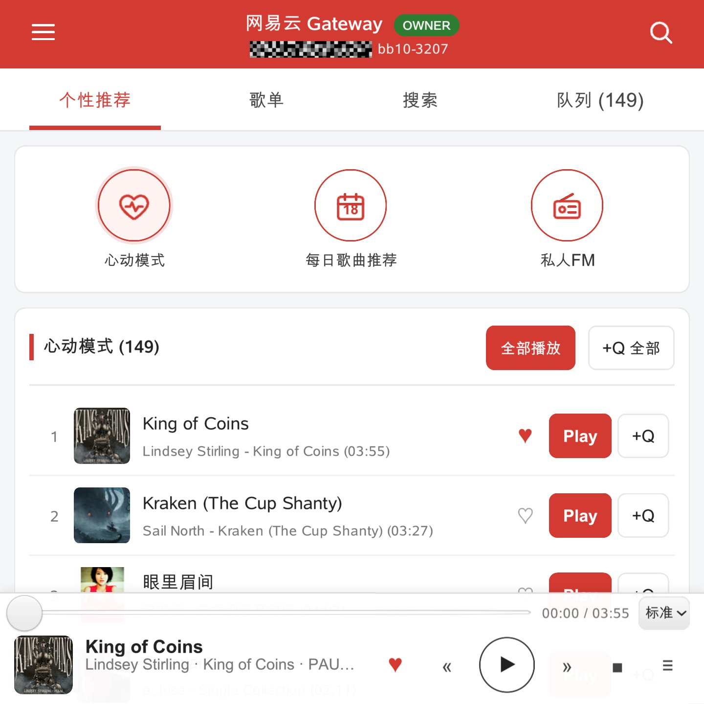
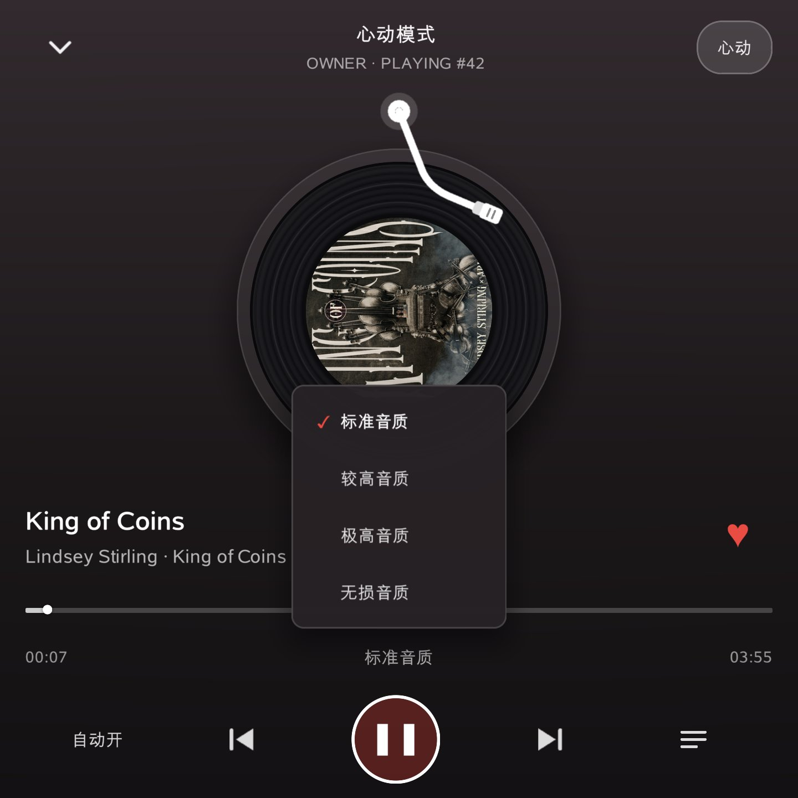

# bb10-music163

[English](README.md) | 简体中文

> 让黑莓 BlackBerry Passport 继续实用地听歌：在 NAS 上运行 Rust 网易云音乐网关，通过内置 OpenSSL TLS 桥接向 BB10 实时转发 Range 音频流，并提供零构建依赖的 ES5 黑胶唱片播放器界面。

| 发现页 / 心动模式与播放队列（BB10 1:1 方屏） | 全屏黑胶唱片界面与音质菜单 |
| --- | --- |
|  |  |

## 为什么做这个项目

BlackBerry 10（OS 10.3.3）早已没有可用的官方音乐客户端，系统底层既缺少现代 TLS 1.2/1.3 加密套件，也无法解码 FairPlay / Widevine 等硬件 DRM 流。与其放弃 Passport 的硬件音频输出与物理按键，`bb10-music163` 将上游接口签名、代理路由与短效 CDN 解析全部放到自建 Rust 网关中完成：

- **原生 BB10 TLS 桥接（`bb10-shell`）**：在轻量 Cascades/Qt4 `.bar` 外壳内嵌一个本地 `127.0.0.1` OpenSSL HTTP-to-HTTPS 桥接，让 BB10 自带 `WebView` 无需修改系统证书即可直连现代 HTTPS 网关，无 SSL 握手失败与证书拦截弹窗。
- **无盘 Range 媒体中继**：对网易云下发的签名 CDN 音频直链（`MP3` / `AAC` / `FLAC`）提供 HTTP `206` 断点拖拽转发与过期链接自动刷新——不在磁盘上留存受版权保护的音频副本。
- **升级只改 NAS 后端**：前端播放器（`web/player.html`，零构建纯 ES5）与接口修复（例如补全超过 1,000 首的“喜欢的音乐”）均托管在服务端，日常更新无需重装 `.bar`。
- **单容器原生 TLS 低功耗常驻**：Rust/Tokio 空闲几乎 0% CPU，在同一容器内原生提供 HTTPS（`:16380`，`rustls` + 自建 Root CA）与局域网 HTTP（`:16381`）双入口——零 Traefik / Sablier 附加容器。

## 工作原理

```text
 BlackBerry Passport (bb10-shell Cascades/Qt4 + WebView)
      │  ▲  本地 HTTP (127.0.0.1)
      ▼  │  LocalTlsBridge (Qt4 + OpenSSL + 内网 Root CA)
 [可选] VPS 四层转发 (TLS_GUARD=1) ──Tailscale──┐
      │                                              │
      ▼                                              ▼
 bb10-music163-gateway（单容器：:16380 HTTPS / :16381 HTTP）
   ├── netease-adapter ──► [可选] socks5h:// 代理 ──► 网易云 API（登录 / 歌单 / 选链）
   ├── media-relay     ──► 直连 CDN 拉流   ──► Range / 206 音频流转发
   └── playback-session ── 单播放权代际仲裁 + STOP ACK 确认
```

## 核心特性

| 模块 | 能力说明 |
| --- | --- |
| **网关与账号鉴权** (`crates/gateway`) | Axum HTTP API + Bearer Token 校验、有界二维码扫码轮询、原子 `0600` Cookie 持久化、突破 1,000 首红心歌单全量补全 |
| **无盘媒体中继** (`crates/media-relay`) | 无状态 HTTP `Range` / `206` 流转发、CDN 短链过期（`403`/`410`）自动续期刷新、SSRF/域名白名单校验、背压流量控制 |
| **单播放权仲裁** (`crates/playback-session`) | 跨桌面 Safari/Chrome 与 BB10 的单调递增 `generation` 状态机、`STOP ACK` 互斥确认、重启代际底线持久化 |
| **ES5 网页播放器** (`web/player.html`) | 零构建纯 ES5 界面，兼容 BB10 WebKit 与现代浏览器：全屏黑胶转盘、音质切换菜单、每日推荐、心动模式、私人 FM、搜索、50 首分页歌单与队列 |
| **BB10 原生外壳** (`bb10-shell`) | 全屏 Cascades Qt4 `.bar` 应用，内置 `LocalTlsBridge`、支持远程/局域网网关地址切换、定制圆角图标与 `check-bar.py` 打包校验 |
| **NAS 原生 TLS 与中继** (`docker-compose.nas-tls.yml`) | 单容器原生 `rustls` HTTPS（`:16380`）+ 局域网 HTTP（`:16381`）+ 有界 `SIGTERM` 优雅退出；兼容 `TLS_GUARD=1` 四层 VPS 转发 |

## 快速开始（一步步上手）

### 方式 A：Docker / NAS 一键部署（推荐）

```bash
# 1. 克隆仓库
git clone https://github.com/ItsLaurelNotYanny/bb10-music163.git
cd bb10-music163

# 2. 生成一个随机访问令牌（GATEWAY_TOKEN，请妥善保存）
openssl rand -hex 32

# 3. 复制环境变量模板并填写配置
cp .env.example .env
```

编辑 `.env`：
- `GATEWAY_TOKEN=<填入上面生成的 64 位随机密钥>`
- `GATEWAY_API_PROXY=socks5h://host.docker.internal:1080` *（如果 NAS 在海外，需要填写可访问网易云的 SOCKS5 代理；国内直连可留空）*

接着构建并启动容器：

```bash
# 方案 1：单容器 HTTP 模式（本地开发 / 局域网最简单，默认端口 16380）
docker compose up -d --build

# 方案 2：单容器 NAS 原生 TLS 模式（:16380 HTTPS + :16381 局域网 HTTP）
docker compose -f docker-compose.nas-tls.yml up -d --build
```

检查服务是否启动成功：

```bash
curl -fsS http://127.0.0.1:16380/health   # （TLS 模式下为 :16381/health 及 https://127.0.0.1:16380/health）
```

### 首次打开网页与扫码登录（BB10 / 手机 / 电脑零安装即可用）

1. 在 BlackBerry Passport 自带浏览器、Safari 或 Chrome 打开 `http://<你的NAS_IP>:16380/player`（TLS 模式打开 `:16381/player` 或 `https://<域名>:16380/player`）。
2. 在页面设置栏 **Token** 中粘贴上面设置的 `GATEWAY_TOKEN`，点击 **连接**。
3. 点击 **扫码登录**，用手机上的官方「网易云音乐」App 扫一扫二维码确认登录。
4. 登录成功后服务端会自动将 Cookie 安全持久化到卷中（`0600` 权限），后续打开页面无需重复扫码。

### 方式 B：本地源码直接运行（Cargo）

```bash
./check.sh --fast
./check.sh

cp config/gateway.example.toml config/gateway.toml
# 编辑 config/gateway.toml 中的 gateway_token 与 api_proxy
cargo run -p gateway -- --config config/gateway.toml capabilities
cargo run -p gateway -- --config config/gateway.toml serve
```

### 方式 C：编译 BlackBerry 10 原生 `.bar` 外壳（外网 HTTPS 免证书弹窗）

如果只在家里局域网通过 HTTP（`http://<NAS_IP>:16380/player`）听歌，Passport 自带浏览器**什么都不用装**即可直接播放。只有当你需要从外网走 HTTPS（`TLS_GUARD=1`）访问、且希望彻底绕开 BB10 原生系统的 TLS 握手失败或证书弹窗时，才需要安装 `.bar` 壳：

1. 将你自建的 Root CA 根证书（PEM 格式）放到 `bb10-shell/assets/ca.crt`。
2. 使用 BB10 原生编译镜像打包：
   ```bash
   ./bb10-shell/scripts/build-bar.sh
   ```
3. 在 Passport 打开 **设置 -> 安全与隐私 -> 开发者模式**，侧载安装生成的 `bb10-shell/build/bb10/bb10-music163.bar`。
4. 打开 App，从屏幕顶部下滑进入 **设置**，填入你的网关 `/player` 地址（`https://...` 或 `http://...`）即可。

## 架构与多平台可行性

`crates/provider-model` 将播放传输模式显式拆分为 `RelayableMedia`、`ProviderSdkPlayback` 与 `RemoteDeviceControl`：
- **网易云音乐**（`RelayableMedia`）：鉴权后下发带时效签名的标准 CDN 音频直链，可无状态中继给老设备 HTML5 `<audio>`。
- **Apple Music / Spotify / TIDAL**（`ProviderSdkPlayback`）：全曲音频全链路采用 FairPlay / Widevine / PlayReady DRM，依赖 BB10 缺失的现代 EME/CDM 运行时。

详见 `crates/provider-model/src/lib.rs` 中的能力模型定义。

## 兼容性与当前状态

- **已验证硬件**：BlackBerry Passport（`SQW100-1`），1440×1440 方屏。
- **已验证系统与浏览器**：BlackBerry 10 OS `10.3.3.3216`（`bb10-shell` + WebKit）、macOS/iOS Safari、Linux/Windows Chrome 与 Firefox。
- **项目状态**：个人日常使用稳定（Rust 网关 + NAS Docker + BB10 `.bar` 外壳）。
- **明确非目标**：将版权曲目落盘保存为永久本地副本、绕过 DRM、多租户公开托管服务。

## 文档索引

[NAS Docker & Auto-Sleep](docs/NAS_DOCKER.md) · [Third-Party Licenses](docs/THIRD_PARTY_LICENSES.md)

## 开源协议

- `crates/provider-model`：`MIT OR Apache-2.0` 双许可。
- `crates/netease-adapter`、`crates/gateway` 及工作区集成：`GPL-3.0-only`（与上游依赖 `netease-cloud-music-api` `2.1.0` 一致）。

详见 [docs/THIRD_PARTY_LICENSES.md](docs/THIRD_PARTY_LICENSES.md)。
